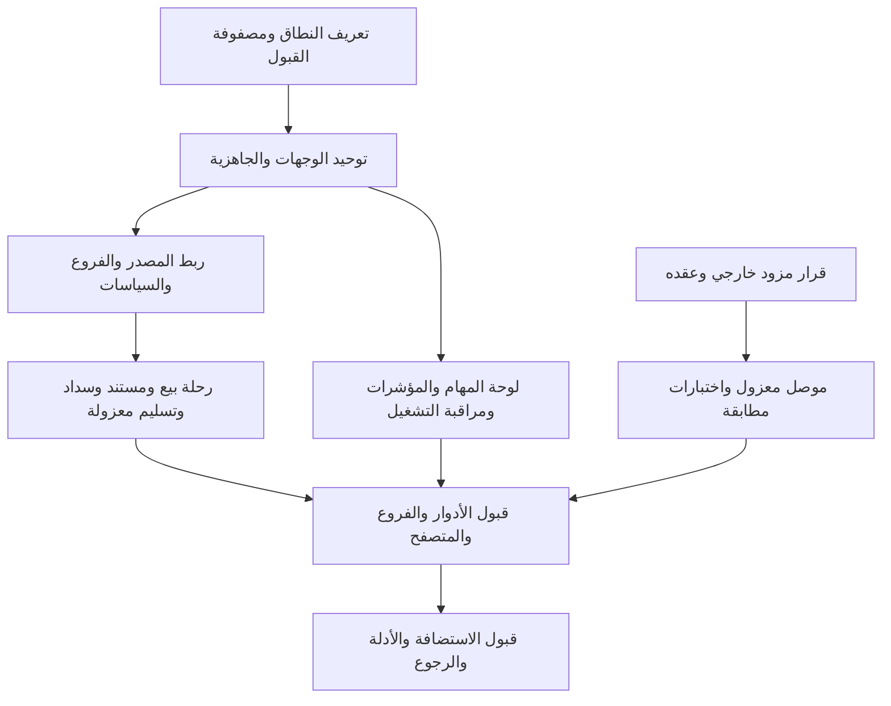

# حصر لوحة الإدارة وخطة الاستكمال

> **تحديث تنفيذ:** نُفذ البندان المطلوبان من المستخدم في الإصدار 1.62.0: الملخص التشغيلي وقوائم الأعمال، وتوحيد مداخل هامش الربح ومستندات أونكس. تفاصيل التنفيذ والقبول في [WORKSPACE-OVERVIEW-1.62.0-AR.md](WORKSPACE-OVERVIEW-1.62.0-AR.md). الحصر والأرقام أدناه سجل للحالة التي سبقت التنفيذ، وبقية الخطة ليست منفذة ضمن هذا الإصدار.

**التاريخ:** 19 أكتوبر 2026. **خط الأساس:** Auto Dealership Core / Car Dealer 1.61.2، ومخطط 1.25.0.

## النتيجة التنفيذية

النظام ليس مجموعة شاشات وهمية: توجد خدمات فعلية للمخزون والعملاء والمشتريات والمبيعات والتمويل والسداد والتسليم. المشكلة الحالية مزيج من **تجربة إدارة بدأت ولم تصل إلى لوحة تشغيل متكاملة، وبنية تكاملات لم تُوصل بمزود إنتاج، وإعدادات وبيانات تشغيلية لم تُستكمل**. بعض ما بدا ناقصًا في تقارير سابقة أُنجز بالفعل، ولذلك لا ينبغي إعادة بنائه.

الأولوية العملية: توحيد مداخل الوحدات وإظهار أسباب توقفها، ثم تجهيز مسار بيع واحد كامل ببيانات صناعية على بيئة منفصلة، ثم بناء ملخص الإدارة فوق البيانات الصحيحة. لا تُنشأ مؤشرات تجميلية أو يُلغى شرط تحقق لجعل لوحة فارغة تبدو مكتملة.

هذه خطة استكمال ومراجعة شفرة وحالة تشغيل، وليست تنفيذًا للتغييرات المقترحة. لم تُعدّل وظائف النظام أو إعداداته ولم تُنشأ حسابات أو معاملات في قاعدة الموقع أثناء هذه المراجعة.

## طريقة المراجعة وحدودها

- جُرد عقد القائمة المركزية في `src/Admin/Navigation.php`: **56 وجهة في 11 مجموعة**، إضافة إلى مساحة العمل الرئيسية. هذا ليس عدد كل الشاشات أو التبويبات أو الوحدات؛ توجد صفحات تفصيلية أو تسجيلات مستقلة خارجه.
- قورنت الشاشات بملفات خدماتها، والتسجيلات والأفعال والتقارير والمهام والتوثيق السابق.
- جُرد **77 اسم إجراء ثابتًا داخل النماذج**. وُجدت تسجيلات حرفية أو ديناميكية لجميع الأسماء المحصورة؛ جرى تقييم 12 تسجيلًا ديناميكيًا في WorkflowPages وReferencePage دون إقلاع WordPress. هذا يثبت الربط البنيوي فقط، ولا يثبت صحة كل صلاحية أو معاملة أو نتيجة حفظ.
- جرى فحص قاعدة البيانات عبر SHORTINIT واستعلامات قراءة فقط، وتشغيل `release-preflight.php --inspect`. لم تُحمّل الإضافة على قاعدة الموقع بغرض تمثيل مدير أو تجربة الأزرار.
- لم تجر جولة متصفح مسجلة الدخول على كل شاشة. نتائج الواجهة أدناه مستندة إلى الشفرة؛ يلزم قبول متصفح معزول لكل دور قبل إغلاق مهامها.
- لا يُعتبر غياب إعداد محفوظ دليلًا على غياب الميزة إذا كان لها إعداد افتراضي. ولا يعني وجود صفحة أو اختبار تاريخي أن الرحلة الحالية مكتملة.

**أدلة قابلة للمراجعة:** [القائمة الكاملة](artifacts/admin-completion-2026-10-19/navigation.json)، [مطابقة إجراءات النماذج](artifacts/admin-completion-2026-10-19/action-crosscheck.json)، [ملخص التشغيل المنقح](artifacts/admin-completion-2026-10-19/runtime-summary.json)، [بوابة الإصدار](artifacts/admin-completion-2026-10-19/release-preflight.json). لا تتضمن الملخصات كلمات مرور أو محتوى محادثات أو أسماء العملاء.

توجد [قائمة مهام CSV](artifacts/admin-completion-2026-10-19/backlog.csv) للفرز والمتابعة؛ تفاصيل القبول والحدود في هذه الوثيقة هي المرجع.

## ما ثبت من حالة التثبيت الحالي

| البند | الحالة المرصودة | دلالته الصحيحة |
|---|---|---|
| بوابة الإصدار | 11 ناجح، 6 غير مجتازة، 9 تحتاج اعتمادًا | ليست جاهزية إطلاق كاملة |
| الفروع / الموردون | 4 فروع، 23 موردًا | بيانات مرجعية موجودة؛ لا تثبت اعتمادها تجاريًا |
| مصدر أونكس | 523 سجل مصدر | لا يساوي 523 مركبة تشغيلية جاهزة |
| المركبات التشغيلية | سجل واحد بحالة received؛ صفر available | قوائم البيع فارغة بسبب عدم الأهلية الحالية |
| استكمال المصدر | 521 سجلًا بحاجة لاستكمال وفق بوابة الإصدار | يلزم الربط والبيانات الصحيحة، لا تعبئة VIN افتراضي |
| ربط المستودعات | 22 مستودعًا غير مربوط | يجب اعتماد خريطة الفرع قبل الاستكمال |
| العملاء / الفرص | عميلان، 4 فرص | حجم صغير لا يمثل اختبار تشغيل شاملًا |
| عروض الأسعار والحجوزات والمبيعات والتسليم وأوامر الشراء | صفر لكل منها | غياب سجل حالي لا يثبت أن خدماتها غير مكتوبة |
| المحادثات | 5 سلاسل | لا تدعي المراجعة اختبار محتواها أو وصول المستخدمين إليها |
| مستندات أونكس / مستندات البوابة | صفر / صفر | الأرشفة موجودة في الشفرة لكن لا توجد أدلة تشغيل مسجلة هنا |
| outbox | 25 مهمة completed | لا يثبت وصول بريد لصندوق المستلم أو صحة جدولة الإنتاج |
| تنبيهات المتابعة / أدلة الإصدار | صفر / صفر | الجداول موجودة، ولا توجد أدلة مسجلة تقفل القبول |
| سياسة الشراء | غير محفوظة | مانع تهيئة/اعتماد قبل تقديم الشراء، وليس غياب الموديول |
| هوية البائع | الاسم موجود؛ العنوان ورقم الضريبة غير مستكملين | تستكمل من صاحب النشاط، ولا تُفترض قيم |
| الاحتفاظ بهوية العملاء | القيمة 0 | التشغيل المجدول للإخفاء غير مفعل بهذه السياسة |
| بريد المتابعات | خيار التفعيل غير محفوظ | الإرسال الخارجي الاختياري غير مفعل افتراضيًا؛ صندوق المتابعة موجود |
| تفعيل أحداث التكامل | لا إعداد تفعيل محفوظ | لا دليل على موصل إنتاج مفعل |
| إعداد حاسبة التمويل | لا نسخة تخصيص محفوظة | تستخدم الخدمة defaults؛ لا يصح وصف الحاسبة بأنها مفقودة |
| إعداد تشغيل المهام | لا mode محفوظ | `JobRuntime::settings()` يرجع auto؛ لا يعني غياب عامل التشغيل |

الأرقام هنا أحدث من أرقام بعض تقارير 11 و17 أكتوبر. يعتمد التخطيط على هذه اللقطة، ولا تُنقل أرقام المركبات التشغيلية من تقرير قديم.

## الحصر حسب الموديول

التصنيف «منفذ» هنا يعني وجود مسار في الشفرة، وليس قبول إنتاج جديدًا في هذه الجولة. «تحسين» اقتراح لتكامل تجربة الإدارة، وليس ادعاء أن خدمة موعودة مفقودة.

| الموديول / الوجهة | الموجود حاليًا | المتبقي أو التصنيف | مرجع الشفرة الأساسي |
|---|---|---|---|
| مساحة العمل `adc-workspace` | بطاقات وحدات، صلاحيات، مجموعات، تحكم حضور الموظف | **استكمال تجربة:** لا ملخص مؤشرات أو قائمة أعمال يومية في render؛ البيانات موزعة في شاشات أخرى | `Admin/WorkspacePage.php:61` |
| القائمة وبطاقات الأقسام | عقد مركزي لـ56 وجهة | **استكمال:** صفحات مسجلة خارجه؛ منها هامش الربح ومستندات أونكس. يلزم توحيد الوصول دون افتراض أن الروابط الحالية كلها معطلة | `Admin/Navigation.php:60`، `Admin/ProfitMarginPage.php:9`، `Sales/OnyxDocuments.php:17` |
| أونكس وربط المخزون | استيراد ومزامنة وصفحات نشر واستكمال وربط | **تهيئة + تحسين دليل العمل:** 521 سجلًا غير مكتمل و22 مستودعًا غير مربوط | `Admin/OnyxInventoryPage.php`، `Inventory/InventoryWorkspace.php` |
| الاستلام والفحص والنقل والاحتجاز والمرتجعات | شاشات وخدمات حالات وتدقيق وصلاحيات | **قبول تشغيلي:** لا يعاد بناء أساسها؛ تجرب على مركبات مؤهلة وأدوار منفصلة | `Admin/InventoryIdentityPage.php`، `Admin/TransferPages.php`، `Admin/VehicleIssuePage.php` |
| صفحات السيارات والعروض والمواصفات والألوان | ناشر مخصص وخدمات ومحررات وصور | **منفذ؛ قبول بيانات وتجربة:** ليست ضمن قائمة الموديولات المتروكة لمجرد أن مصدر المخزون غير مؤهل | `Admin/CatalogPublishingPage.php`، `Admin/OfferPublishingPage.php`، `Content/VehiclePostEditor.php` |
| الموردون وتكاليف الاقتناء | خدمات موردين وحقول تكاليف بصلاحيات مخصصة | **قبول/اعتماد:** مراجعة البيانات وصلاحيات تكلفة الشراء، وليس إنشاء موديول جديد | `Admin/SupplierPage.php`، `Admin/VehicleAcquisitionPage.php` |
| أوامر الشراء | إنشاء وتقديم وموافقة وإلغاء واستلام وسياسة مجمدة | **تهيئة أساسية ناقصة:** سياسة الشراء غير معتمدة؛ ثم قبول رحلة فصل المهام | `Purchasing/PurchaseOrderService.php:13`، `Admin/PurchaseOrderPage.php` |
| الفرص والرسائل وتجارب القيادة | مراحل وتعيين ورد وحالة موعد مرتبطة بالعميل | **منفذ أساسيًا:** تحسين المداخل والأسماء والتوقيت؛ تقويم السعة ومنع تعارض المواعيد نطاق إضافي إن طُلب | `Admin/OperationsPages.php`، `Admin/RequestPage.php:15`، `Leads/RequestWorkflow.php` |
| ملف العميل | أقسام مستقلة، عدّاد وتنقّل وروابط لتفاصيل العمليات | **منفذ؛ تحسين وضوح فقط:** لا تُعاد مهمة إضافة pagination المذكورة قديمًا | `Admin/CustomerWorkspacePage.php:43` وما بعده |
| مراجعة هويات العملاء | معاينة ودمج CRM محدود ومحمي | **حد نطاق مقصود:** لا يدمج تاريخًا ماليًا أو حسابين مؤكدين؛ لا توسع تلقائيًا إلى إعادة كتابة مستندات مالية | `Leads/CustomerIdentity.php:309` |
| عروض الأسعار ودورة المبيعات | حسابات ولقطات أسعار وتاريخ وإجراءات حجز وبيع | **تحسين مثبت:** اختيارات العميل والمركبة ذات بحث بسيط وLIMIT 200 تحتاج اختيارًا قابلًا للوصول لكل النتائج | `Admin/SalesJourneyPage.php:74` |
| الاعتمادات والخصومات والحجوزات | قرارات وحالات وصلاحيات وفصل مهام | **قبول طرفي:** إثبات رفض المراجع لنفسه، انتهاء الحجز والتنافس والتراجع؛ لا توجد ضرورة لإعادة بناء الخدمة | `Admin/WorkflowPages.php:13`، `Reservations/ReservationService.php` |
| المبيعات والمستندات المالية | بيع واعتماد ومرجع فاتورة وأرشفة PDF أونكس ومطابقة | **قرار مصدر + قبول:** الأرشيف موجود؛ الإصدار الرسمي الآلي من داخل المنصة ليس نفس الأرشفة ولا يُفترض ضمن النطاق | `Sales/SalesService.php`، `Sales/OnyxDocuments.php:28` |
| التمويل | طلبات متعاقبة وقرارات يدوية وشروط ومرجع مزود | **منفذ يدويًا؛ جزئي آليًا:** الموصل الخارجي وشروط اعتماده لم يكتمل تنفيذهما لمزود محدد | `Admin/WorkflowPages.php:84`، `Sales/SalesService.php`، `Integrations/` |
| السداد والاسترداد وإلغاء البيع | تسجيل يدوي ومراجعة مستقلة وخدمات تعويض وحالات | **منفذ يدويًا؛ قرار نطاق:** لا يُسمى بوابة دفع آلية أو مطابقة بنكية تلقائية | `Admin/PaymentPages.php`، `Admin/RefundPage.php`، `Sales/SaleCancellationService.php` |
| التسليم | قائمة مستندات وتجهيز وتأكيد VIN واعتماد وإطلاق | **قبول مترابط:** اختبار الربط بسداد موثق والمستندات وحالات الإلغاء | `Admin/WorkflowPages.php:108`، `Delivery/DeliveryService.php` |
| محادثات العملاء والتقييمات والمستندات | صندوق موظفين وخصوصية ومراجعة ورفع ونشر مستندات | **منفذ؛ قبول صلاحيات:** لا تُختزل الحالة إلى شكل واجهة العميل فقط | `Portal/PortalAdmin.php`، `Portal/PortalOperations.php`، `Portal/CustomerJourney.php` |
| الحملات والنشرة | محرر ومعاينة وحملات وطابور إرسال وإلغاء اشتراك | **منفذ:** المتبقي قبول إرسال ومراقبة تشغيل؛ تتبع bounce خارجي قرار مزود، وليس زر حفظ مفقودًا | `Admin/NewsletterPage.php:12`، `Leads/NewsletterService.php:34` |
| المتابعات والتنبيهات | صندوق دائم وإقرار وتصعيد وعامل ومهمة بريد | **منفذ في الشفرة:** يلزم تفعيل/قبول إرسال ومراقبة؛ ليس موديول تنبيهات غير موجود | `Operations/FollowUpNotifications.php:69`، `Admin/FollowUpPage.php` |
| التقارير والتصدير | تجميع حسب الفرع والحالة والفترة واستثناءات وCSV مدقق | **تحسين تحليلي:** لا تحويل/اتجاهات/تنقل تفصيلي شامل في التقرير الحالي | `Reports/OperationalReport.php:13`، `Admin/OperationalReportPage.php` |
| الهوية والمحتوى والبريد والحاسبة وهامش الربح | إعدادات فعلية ومعاينات وحفظ ومصدر defaults | **تهيئة + اتساق:** اعتماد القيم وربط الصفحات بالقائمة؛ لا إعادة إنشاء الموديولات | `Core/ProductSetup.php`، `Admin/FinanceCalculatorPage.php`، `Admin/ProfitMarginPage.php` |
| المستخدمون والأدوار وسجل التدقيق | أدوار ومراجعة وصول وتعليق وصلاحيات مؤقتة وسجل ببحث وتنقّل | **منفذ؛ قبول مصفوفة:** منع توسيع الصلاحيات لمجرد جعل بطاقة تظهر | `Admin/RoleManager.php`، `Admin/AccessReviewPage.php`، `Admin/AuditPage.php` |
| أمن الواجهة | حدود دخول حديثة وشاشة عرض أمن عامة | **فجوة عرض مؤكدة:** الشاشة تدور على PUBLIC_ENDPOINTS فقط، فلا تعرض كل سياسات المصادقة والتسجيل الجديدة | `Admin/SecurityPage.php:35`، `Security/PublicRequestGuard.php:11` |
| التكاملات | عقود وسجل وتفعيل ومطابقة وإقرار وطابور | **بنية مكتملة جزئيًا:** لا تنفيذ إنتاج ظاهر لـAdapterContract في المصدر؛ لا يُفعّل مسار لمجرد وجوده في القائمة | `Integrations/AdapterContract.php`، `Integrations/IntegrationRegistry.php` |
| المهام والجاهزية والاحتفاظ | تشغيل auto/browser/server ومراقبة وأدلة إصدار وخدمة إخفاء بيانات | **تهيئة/اعتماد وقبول:** تسجيل المهام لا يثبت تنفيذها عند غياب الزيارات؛ سياسة الاحتفاظ صفر وأدلة الإصدار صفر | `Operations/JobRuntime.php:17`، `Operations/ReleaseEvidence.php:10`، `Privacy/RetentionService.php:16` |

## الفجوات ذات الأولوية ومعايير إغلاقها

### ADM-01 — مصدر واحد للقائمة والبطاقات والروابط

**P1 — برمجي؛ 2–3 أيام عمل مبدئيًا.**

توحيد تعريف الوجهات والتبويبات التفصيلية والتسجيلات الإضافية في عقد واضح، خصوصًا `adc-profit-margin` و`adc-onyx-documents`. حفظ الروابط القديمة وإظهار روابط مناسبة لدور الموظف. صفحات التفاصيل يمكن أن تكون مخفية عمدًا من القائمة؛ يلزم تعريفها كوجهة تفصيلية بدل نسخها كبطاقة عامة غير مفهومة.

**القبول:** مقارنة آلية بين الشاشات المسجلة والعقد، وعدم وجود وجهة مقصودة يتيمة؛ ظهور هامش الربح للإدارة فقط؛ وصول المخولين إلى مستند البيع عبر مسار واضح؛ الروابط القديمة تعمل، والطلب المباشر غير المخول يظل مرفوضًا.

### ADM-02 — تحويل مساحة العمل إلى لوحة تشغيل

**P1 — استكمال تجربة؛ 4–6 أيام. يعتمد على ADM-01 وتعريف المؤشرات.**

الترتيب المقترح: اختيار الفرع والفترة ← مؤشرات العمل ← «المطلوب مني الآن» ← المعاملات المتعثرة ← صحة البيانات والمهام ← روابط الوحدات الموجودة. مؤشرات البداية: فرص جديدة/متأخرة، طلبات خصم وبيع تنتظر، حجوزات تقترب من الانتهاء، سداد أو استرداد يحتاج مراجعة، وتسليم جاهز. المدير يرى تجميع نطاقه، والموظف يرى أعماله المسموح بها.

**القبول:** لكل مؤشر تعريف حسابي ومصدر وزمن تحديث ووجهة تفاصيل؛ العدد يطابق قائمة الوجهة بالفلاتر نفسها؛ الصفر يختلف بصريًا عن خطأ التحميل؛ لا كشف لمبالغ أو تكاليف لدور غير مالي؛ اختبار بيانات كبيرة وميزانية استعلامات متفق عليها. لا تُستخدم أرقام كتالوج السيارات كمبيعات أو مخزون متاح.

### ADM-03 — جاهزية عملية تشرح سبب توقف كل وحدة

**P0 — واجهة وربط قراءة؛ 2–4 أيام.**

تجميع الفحوص الموجودة في شاشة واضحة: «غير مهيأ»، «يحتاج اعتمادًا»، «جاهز للاختبار»، «مقبول تشغيليًا». لكل بند السبب والجهة المسؤولة وزر انتقال لشاشة إكماله. تشمل الفروع وربط المستودعات والهوية وسياسة الشراء والاحتفاظ والبريد والمصدر والمستندات.

**القبول:** يستطيع المدير تفسير فراغ قائمة البيع من الواجهة؛ لكل مانع معالجة محددة؛ لا تعرض الموافقات على أنها ناجحة بمجرد حفظ بيانات؛ لا تُلغى قيود البيع أو يضاف مخزون تجريبي في قاعدة الموقع لإغلاق التنبيه.

### ADM-04 — إكمال مسار المصدر إلى مركبة قابلة للبيع

**P0 — تهيئة مع تحسين مسار العمل؛ 2–4 أيام برمجة عند الحاجة، ومدة إدخال البيانات منفصلة. يعتمد على خريطة المستودعات المعتمدة.**

استعمال خدمات أونكس الحالية وربط المستودعات بالفروع الصحيحة، ثم التحقق من VIN والهوية والاستلام والفحص والأهلية. تحسين المرشحات ورسائل أسباب النقص إذا لم تكفِ الشاشات الحالية، بدل إنشاء مستورد جديد.

**القبول:** مركبة صناعية في بيئة الاختبار تنتقل من المصدر إلى available بعد الشروط الصحيحة، وتظهر للاختيار؛ مطابقة العدد مع تفاصيل النواقص؛ إعادة الاستيراد لا تكررها؛ اختفاء المصدر يمنع تعاملًا جديدًا ويُظهر التعارضات مع التعاملات القائمة.

### ADM-05 — اختيار العملاء والمركبات دون سقف خفي

**P1 — برمجي؛ 2–3 أيام. يعتمد على ADM-04 لاختبار الاختيار الفعلي.**

استبدال قوائم أول 200 نتيجة في دورة المبيعات ببحث خادمي وتنقّل واختيار واضح؛ احترام نطاق الفرع والمالك والأهلية، وعدم تمرير كل بيانات العملاء إلى المتصفح.

**القبول:** يمكن اختيار سجل مؤهل بعد النتيجة 200؛ لا يظهر سجل خارج نطاق المستخدم؛ إعادة التحقق من الأهلية عند الحفظ؛ معالجة فشل البحث وتغير الحالة أثناء الاختيار؛ عربية/إنجليزية ولوحة مفاتيح.

### ADM-06 — ربط ووضوح تفاصيل الأعمال

**P1 — تحسين؛ 2–3 أيام. يعتمد على ADM-01.**

توحيد عرض أسماء الموظفين بدل المعرّفات الخام حيث يناسب، وإظهار توقيت الموقع بوضوح مع بقاء التخزين UTC، ورسائل حالات عملية وروابط عودة تحفظ المرشحات. يشمل المتابعات والطلبات والتمويل والتسليم، مع المحافظة على تنقّل ملف العميل الموجود.

**القبول:** من العميل يمكن الوصول للعرض والحجز والبيع والمستند والإجراء المخول ثم العودة؛ لا تضيع فلاتر القائمة؛ كل تاريخ يبيّن التوقيت؛ لا يوهم النص بوجود دفع تلقائي أو إرسال مضمون.

### ADM-07 — إغلاق رحلة المستندات والبيع والسداد والتسليم

**P1 — ربط وقبول؛ 3–5 أيام. يعتمد على ADM-04 وقرار مصدر المستند الرسمي.**

اعتماد مصدر الفاتورة: إن بقي أونكس، نستكمل مسار الأرشفة والمطابقة والمرجع والدخول إلى المستند، لا نبني نظام فواتير جديدًا موازيًا. فصل المستند المالي الأصلي عن المستند المنشور للعميل، وتوضيح من يراجع وينشر ويلغي.

**القبول:** رحلة صناعية من فرصة إلى عرض وحجز وبيع وفاتورة موثقة وسداد مستقل وتسليم؛ رفض عدم تطابق المبالغ والمرجع؛ الإلغاء والاسترداد لا يتلفان الأصل؛ تنزيل المستند مقيد ومسجل وفق سياسة التدقيق المعتمدة. يتضمن ذلك إعادة التحقق من فجوة فشل تدقيق تنزيل مستند البوابة المذكورة في المراجعة الأمنية، دون الادعاء بإصلاحها هنا.

### ADM-08 — مراقبة التشغيل والمتابعات والبريد

**P1 — تهيئة وربط مراقبة؛ 2–4 أيام؛ الاعتماد الخارجي منفصل.**

استعمال JobRuntime وFollowUpNotifications وoutbox الحالية. عرض آخر تنفيذ ناجح وعمر التأخر وسبب التعطل ومسار إعادة المحاولة المخول. تفعيل البريد بعد اختبار النقل والهوية، والتفريق بين قبول الإرسال وإقرار الموظف ووصول البريد للمستلم.

**القبول:** التذكير والتصعيد وإقرار الاطلاع تعمل دون تكرار؛ اختبار غياب زيارات الموقع وانقطاع العامل ثم عودته؛ تنبيه واضح للمهام المتأخرة؛ عدم إرسال رسائل قديمة خارج حدود السياسة؛ إثبات تشغيل المجدول على الاستضافة المقصودة.

### ADM-09 — استكمال شاشة مراقبة الأمان

**P1 — برمجي؛ 1–2 يوم.**

إظهار ملخص سياسات المصادقة والتسجيل والشبكة وكلمات مرور التطبيقات الموجودة في 1.61.2، مع فصلها عن مسارات API العامة. عرض الحدود ومؤشرات جاهزية التخزين والبروكسي والنظافة المجدولة دون كشف عنوان الزائر أو بصمة الحاوية أو بيانات اعتماد.

**القبول:** السياسات المعروضة تطابق PublicRequestGuard::POLICIES، وتظهر سياسة الحساب + الشبكة والحد الاحتياطي؛ حماية القراءة بالصلاحية؛ لا زر تعطيل شامل يفتح التخمين؛ لا تُعرض حالة إعداد البروكسي كضمان لصحتها الفعلية.

### ADM-10 — تقارير إدارية قابلة للتفسير والتنقل

**P2 — تحسين؛ 3–5 أيام. يعتمد على ADM-02 وقرار مؤشرات العمل.**

إضافة الانتقال من التجميع إلى القائمة المطابقة، ومقارنة فترتين ومعدل التحويل إن اعتمد تعريفه. لا يضاف «ربح» بتسمية نهائية اعتمادًا على سعر العرض فقط؛ يستعمل تعريفًا معتمدًا وتكاليف مخولة. التقارير التشغيلية والتصدير الحالية تبقى أساس التنفيذ.

**القبول:** تطابق التقرير مع قوائم المصدر والتصدير؛ تحديد الحالات والتواريخ المستعملة في كل مؤشر؛ احترام صلاحيات المبالغ والتكاليف؛ حدود للنطاق وحجم التصدير.

### ADM-11 — موصل خارجي واحد وفق نطاق معتمد

**P2 أو P0 إذا كان التكامل شرط إطلاق — تنفيذ جديد فوق البنية الحالية؛ 5–10 أيام لكل مزود كتقدير أولي بعد استلام عقده.**

اختيار التكامل المطلوب فعلًا: تمويل أو دفع أو محاسبة/ERP. لا تُنفذ كل الموصلات المحتملة. تحديد الأحداث والبيئة والمصادقة والتوقيع والتكرار والمطابقة، ثم تنفيذ AdapterContract والجاهزية والمصالحة باستخدام الطابور الحالي.

**القبول:** نجاح sandbox، والتحقق من الرسائل الواردة والتكرار وإعادة الترتيب وإعادة المحاولة والاختلافات؛ لا أثر مالي مزدوج؛ التفعيل مدقق وقابل للإيقاف. إن لم يكن المزود ضمن الإصدار، يسجل الاستبعاد وتبقى المسارات معطلة بدل وصفها بمكتملة.

### ADM-12 — سياسات الشراء والهوية والاحتفاظ

**P0 للإعدادات المعطلة، وP1 لأي فجوة برمجية تثبت بعد اعتمادها؛ 2–4 أيام تقنية.**

تسجيل سياسة الشراء وهوية البائع والقيم المعتمدة عبر الخدمات الحالية. اعتماد سياسة احتفاظ لفئات البيانات وتحديد ما يُخفى وما يحتفظ به وما يحتاج تعليق حذف؛ لا يكفي تغيير مدة إخفاء بيانات العميل لتمثل سياسة المستندات المالية كلها. لا تتضمن الخطة افتراض مدد قانونية أو إتلافًا للوثائق.

**القبول:** اعتماد مسجل وإصدار سياسة واضح؛ رفض إعداد غير صالح؛ معاينة أثر retention في بيئة منفصلة؛ حفظ الأصول المقررة وعدم حذف سجل بسبب كونه قديمًا فقط؛ اختبار التراجع عند فشل التدقيق.

### ADM-13 — قبول آلي للوحة وتحديث مراجع الحالة

**P1 — اختبارات وتوثيق؛ 3–5 أيام. يبدأ من المرحلة الأولى.**

ربط اختبارات قاعدة معزولة وHTTP/متصفح بمسارات الإدارة، لا الاكتفاء بـsyntax وoffline في CI. إصلاح نقص تهيئة اختبار الترجمة الذي أظهرته الجولة السابقة، ثم توحيد وثائق الجاهزية القديمة. اختبار دخول المدير والمبيعات والمخزون والمالية والمراجع بأقل صلاحياتهم.

**القبول:** تثبيت حزمة على WordPress مدعوم، وتشغيل سيناريوهات الأدوار والفروع والهوية والرفض؛ نجاح الرحلة التجارية وحالات فشل التخزين والتزامن؛ تشغيل العربية والإنجليزية وأحجام عرض مناسبة؛ كل نتيجة مربوطة بإصدار وبيئة. لا تشغّل اختبارات access-governance أو أي fixture على قاعدة الموقع.

### ADM-14 — قبول بيئة الاستضافة وإغلاق أدلة الإصدار

**P0 قبل النشر — تشغيل واعتماد؛ 2–4 أيام تقنية دون انتظار الموافقات. يعتمد على المهام المطلوبة للإصدار.**

إكمال HTTPS والعنوان الحقيقي والوكيل والجدولة والبريد والنسخة الاحتياطية والاستعادة على مضيف مستقل، مع سجل الأدلة الموجود. إغلاق بنود الأمن الأخرى المذكورة في SECURITY-REVIEW-2026-10-19-AR.md ضمن نطاقها، لا اعتبار تعديل داشبورد إصلاحًا لها.

**القبول:** فحص آلي على الحزمة وبيئة النشر نفسها، وأدلة مراجعة مستقلة حيث تتطلب البوابة ذلك، وخطة رجوع مجربة. لا تنقل موافقات إصدار قديم إلى إصدار جديد دون تحقق صلاحيتها.

## قرارات نطاق لا تُحوّل تلقائيًا إلى أعمال ناقصة

| القرار | الوضع الحالي | التوصية لهذه الخطة |
|---|---|---|
| الفوترة الرسمية | أرشيف ومستندات مصدر أونكس، وليست منظومة إصدار آلية محلية كاملة | تثبيت المصدر أولًا؛ أي مولد فواتير مشروع مستقل إن اعتمد |
| التحصيل والتمويل الآلي | مسارات مراجعة يدوية وبنية موصلات | استكمال موصل محدد فقط عند حاجة الإطلاق |
| تقويم تجربة قيادة وسعة موارد | إدارة حالة وتاريخ ووقت طلب موجودة | تحسين اختياري؛ لا يوصف كأساس مكسور دون مطلب حجز موارد |
| دمج تاريخ عميل مالي | الاستبعاد مقصود لحماية المراجع والوثائق | أبقِ الدمج الحالي محدودًا؛ يمكن بحث ربط عرض تاريخي دون تعديل الأصول |
| تتبع ارتداد وتسليم الحملات | حملات وطابور وإلغاء اشتراك موجودة | يعتمد على مزود البريد؛ ليس شرطًا لبناء المحرر من جديد |
| نسخ احتياطي عام من لوحة الإدارة | توجد أدوات وأدلة تشغيل محلية | الأولوية لاستعادة آمنة مجربة؛ لا إضافة زر تنزيل قاعدة قد يكشف العملاء |

## ترتيب التنفيذ والاعتماديات

| المرحلة | النتيجة المطلوبة | المهام | شرط الانتقال |
|---|---|---|---|
| 1: تثبيت النطاق والواجهات | قائمة وظائف وحالات جاهزية موحدة | ADM-01، ADM-03، بدء ADM-13 | كل وجهة مقصودة معروفة، وكل نقص مصنف برمجيًا أو تشغيليًا أو قرار نطاق |
| 2: أهلية البيانات والسياسات | مجموعة صناعية مؤهلة لرحلة كاملة | ADM-04، ADM-12 | مطابقة المصدر والفروع والهوية والسياسات دون تجاوز تحقق |
| 3: إكمال تجربة الموظف | ملخص أعمال وتنقّل واختيار وتفاصيل واضحة | ADM-02، ADM-05، ADM-06، ADM-09 | عدد المؤشر يطابق التفاصيل ودور المستخدم |
| 4: إغلاق الرحلة والتشغيل | مستندات وسداد وتسليم وتنبيهات مثبتة | ADM-07، ADM-08، إكمال ADM-13 | رحلة ناجحة وحالات رفض وفشل وتزامن على نسخة معزولة |
| 5: تحسين وقبول نشر | تقارير مختارة وبيئة نشر وأدلة رجوع | ADM-10 إن اعتمد، ADM-14 | عدم بقاء مانع غير محسوم ضمن نطاق الإطلاق |
| مسار مستقل | تكامل إنتاج اختياري | ADM-11 | قرار مزود وعقد اختبار قبل التطوير والتفعيل |

**التقدير:** مدد المهام تقديرات جهد تقنية أولية، ولا تُجمع كموعد تسليم لأنها تتداخل وتحتاج تحقق متصفح وتحديد النطاق. لا تشمل انتظار بيانات المعرض أو موافقات أو حسابات المزودين. بعد مرحلة 1 يثبت تقدير زمني للإصدار المطلوب؛ لا يوجد أساس موثوق لإعطاء نسبة إنجاز عامة للنظام الآن.

**المسؤوليات:** المطور للواجهات والخدمات والاختبارات؛ مسؤول المخزون لخريطة الفروع والهوية والأهلية؛ الإدارة/المالية للسياسات والمستند الرسمي والفصل بين المهام؛ التشغيل للبريد والجدولة والاستضافة والاستعادة؛ مراجع مستقل لقبول النتائج الحساسة. لا يفترض توافر عدة مطورين أو تنفيذ متوازٍ ما لم يعتمد لاحقًا.

## معيار الإكمال النهائي

تعتبر الوظيفة مستكملة عندما يمكن الوصول إليها من الدور الصحيح، وقراءة سبب عدم الإتاحة إن وجِد، وتنفيذها على بيانات صحيحة، والتحقق من النتيجة والتدقيق، وتجربة الرفض والفشل والتراجع، ثم إرفاق دليل مرتبط بالإصدار. حفظ صفحة أو زيادة عدد البطاقات أو اختفاء رسالة الخطأ وحده ليس معيار إكمال.

**البدء المقترح:** ADM-01 وADM-03 مع اختباراتهما؛ بعدهما ADM-04 وADM-12. يؤسس ذلك شاشة يمكن الوثوق بها قبل بناء مؤشرات فوق بيانات غير مكتملة.
